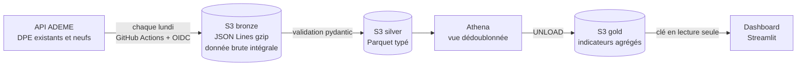

# dpe-dvf-platform

[](https://github.com/bna-learner/dpe-dvf-platform/actions/workflows/ci.yml)

Plateforme de données sur AWS qui collecte chaque semaine les **diagnostics de performance énergétique (DPE)** publiés par l'ADEME, les transforme en couches bronze, silver et gold, et les expose dans un dashboard public sur les **passoires thermiques**.

**👉 Dashboard : [dpe-france-natchia.streamlit.app](https://dpe-france-natchia.streamlit.app/)**
*(hébergement gratuit : s'il est en veille, un clic le réveille en quelques secondes)*

---

## Architecture



- **Ingestion** : client Python de l'API ADEME (pagination par curseur, réessais avec backoff exponentiel, contrôle de complétude), sur une fenêtre glissante de dates.
- **Bronze** : copie fidèle de la source, immuable et partitionnée par jeu de données, date d'ingestion et fenêtre.
- **Silver** : validation et typage avec pydantic, Parquet au schéma explicite, mise en quarantaine des lignes invalides.
- **Gold** : indicateurs calculés en SQL par Athena et matérialisés en Parquet.
- **Infrastructure** : entièrement décrite en Terraform, avec un state distant et verrouillé sur S3.
- **Sécurité** : aucune clé AWS stockée dans GitHub (OIDC), moindre privilège sur chaque identité.

## Chiffres clés

| | |
|---|---|
| DPE dans la plateforme | ~973 000, logements existants et neufs, depuis juin 2026 |
| Volume | bronze 637 Mo → silver 62 Mo → gold < 13 Ko |
| Couverture du département | 99,999 % (dont ~11 % déduits du code postal) |
| Coût AWS mensuel | quelques centimes |

## Décisions fondées sur des mesures

Chaque choix structurant est documenté dans un [ADR](docs/adr/), et repose sur une mesure plutôt que sur une hypothèse.

**1. L'API pour l'incrémental, pas pour le chargement initial.**
L'API de l'ADEME est bridée à environ 500 ko/s en accès anonyme, pour environ 6 ko par DPE : charger les 15,6 millions de DPE existants prendrait plusieurs jours. Elle sert donc à l'ingestion hebdomadaire ; le dump complet de l'ADEME (74 Go, téléchargé à environ 23 Mo/s) est prévu pour le chargement historique.

**2. Une fenêtre d'ingestion dimensionnée sur le délai de publication.**
L'ADEME publie les DPE par lots, plusieurs jours après leur réception. Une requête de contrôle a mesuré un retard allant jusqu'à **18 jours**, et montré qu'avec la fenêtre initiale de 8 jours, **47 858 DPE (environ 5 % de la base) auraient été perdus silencieusement** en une seule semaine. La fenêtre a été élargie, et ce retard est contrôlé à chaque ingestion.

**3. Écarter une valeur plutôt que rejeter une ligne.**
253 DPE étaient rejetés à cause d'années de construction impossibles (ex. 2028). La valeur aberrante est désormais écartée et comptée, le DPE est conservé, et la valeur d'origine reste disponible en bronze.

**4. Un repli traçable pour la géolocalisation.**
Près d'un DPE sur quatre n'est pas géocodé à l'adresse par la Base Adresse Nationale, et 11 % n'avaient pas de département. Le département est déduit du code postal saisi (Corse et outre-mer compris), avec une colonne qui indique la source : de 96 106 DPE sans département à 9.

**5. Une seule clé permanente, réduite au minimum.**
Le dashboard, hébergé hors d'AWS, ne peut pas utiliser l'OIDC. Il lit gold avec un utilisateur IAM dont la seule permission est la lecture de ce bucket : une fuite ne donnerait accès qu'à des agrégats de données ouvertes ([ADR-0003](docs/adr/0003-acces-du-dashboard-aux-donnees-gold.md)).

## Stack

Python 3.12 · uv · pydantic · httpx · pyarrow · boto3 · pytest · ruff · mypy (strict)
AWS : S3, Glue Data Catalog, Athena, IAM (OIDC) · Terraform · GitHub Actions · Streamlit

## Structure du dépôt

```
dpe-dvf-platform/
├── src/dpe_dvf/
│   ├── ingestion/        # Client de l'API ADEME, modèle DPE, fenêtres, écriture bronze
│   └── transformation/   # Silver (validation, Parquet), règles géographiques, gold (Athena)
├── sql/
│   ├── athena/           # Vue de dédoublonnage et requêtes de contrôle
│   └── gold/             # Une requête par indicateur du dashboard
├── dashboard/            # Application Streamlit
├── infra/                # Terraform : S3, Glue, Athena, IAM, OIDC
│   └── bootstrap/        # Bucket du state Terraform
├── tests/                # Tests unitaires, sans réseau
├── docs/adr/             # Décisions d'architecture
└── .github/workflows/    # CI et ingestion hebdomadaire
```

## Démarrage

### Prérequis

- [uv](https://docs.astral.sh/uv/)
- [AWS CLI](https://docs.aws.amazon.com/cli/) ≥ 2.32 et [Terraform](https://developer.hashicorp.com/terraform) ≥ 1.10, pour la partie cloud

### Installation et tests

```bash
uv sync
uv run pre-commit install
uv run pytest
```

### Pipeline en local

```bash
cp .env.example .env    # puis renseigner les valeurs
uv run dpe-ingestion --dataset neuf --debut 2026-08-01 --fin 2026-09-01
uv run dpe-silver
uv run dpe-gold         # nécessite des identifiants AWS et DPE_DVF_BUCKET_GOLD
```

### Dashboard en local

Créer `.streamlit/secrets.toml` (non versionné) avec une section `[aws]` : `access_key_id`, `secret_access_key`, `region`, `bucket_gold`. Puis :

```bash
uv run --group dashboard streamlit run dashboard/app.py
```

### Infrastructure

```bash
cp infra/backend.hcl.example infra/backend.hcl   # puis renseigner le bucket de state

cd infra/bootstrap
terraform init -backend-config=../backend.hcl
terraform plan

cd ..
terraform init -backend-config=backend.hcl
terraform plan
```

## Qualité et sécurité

- **CI obligatoire** sur chaque PR : ruff, mypy strict, pytest avec couverture minimale de 90 %. La branche `main` est protégée.
- **Aucune clé AWS dans GitHub** : le workflow d'ingestion obtient des identifiants temporaires par OIDC, limités à la branche `main`.
- **Moindre privilège** : chaque identité n'a que les permissions nécessaires ; bronze et silver ne peuvent pas être supprimés par le pipeline.
- **Garde-fous de coût** : budget AWS avec alertes, limite d'1 Go lu par requête Athena, expiration automatique des fichiers temporaires.
- **Contrôles de données** : complétude de chaque ingestion, réconciliation des volumes entre couches, retard de publication et fraîcheur ([`sql/athena/`](sql/athena/)).

## Limites connues

- Un DPE n'est établi qu'à la vente, à la location ou à la construction : la base **n'est pas représentative** de l'ensemble du parc immobilier.
- L'historique commence en juin 2026 ; le chargement complet depuis 2021 est prévu.
- Le dédoublonnage repose sur une vue Athena, et silver est recalculé entièrement à chaque exécution : adapté au volume actuel, à faire évoluer avec le chargement historique.
- Le dashboard n'est pas encore couvert par des tests.

## Feuille de route

- **V2** : chargement historique depuis le dump de l'ADEME, données de valeurs foncières (DVF) et rapprochement DPE ↔ ventes, mesure de la « valeur verte » d'un logement.
- **Industrialisation** : dbt pour les transformations, Databricks et Delta Lake, orchestration avec Airflow.
- **IA générative** : recommandations de travaux de rénovation, appuyées sur les bouquets de travaux des DPE.

## Données

Données DPE : [ADEME](https://data.ademe.fr/), sous [Licence Ouverte 2.0](https://www.etalab.gouv.fr/licence-ouverte-open-licence).

---

Réalisé par **Bienvenu Natchia**, data engineer · [natchiadata.dev](https://natchiadata.dev) · [LinkedIn](https://www.linkedin.com/in/natchia-data-engineer-ia/)
